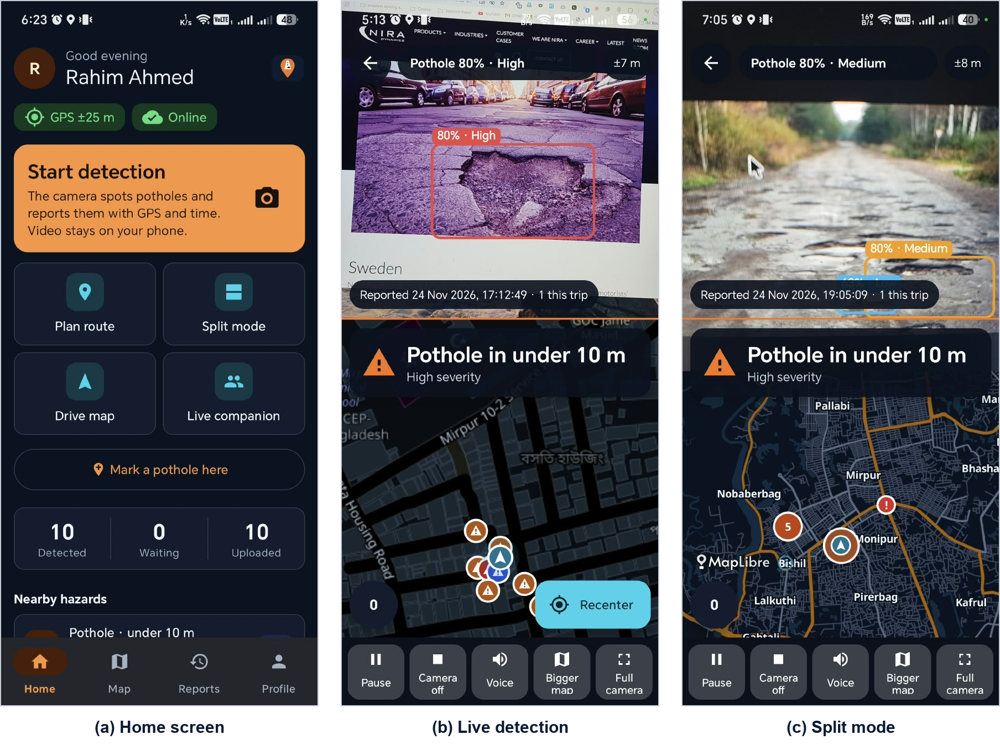
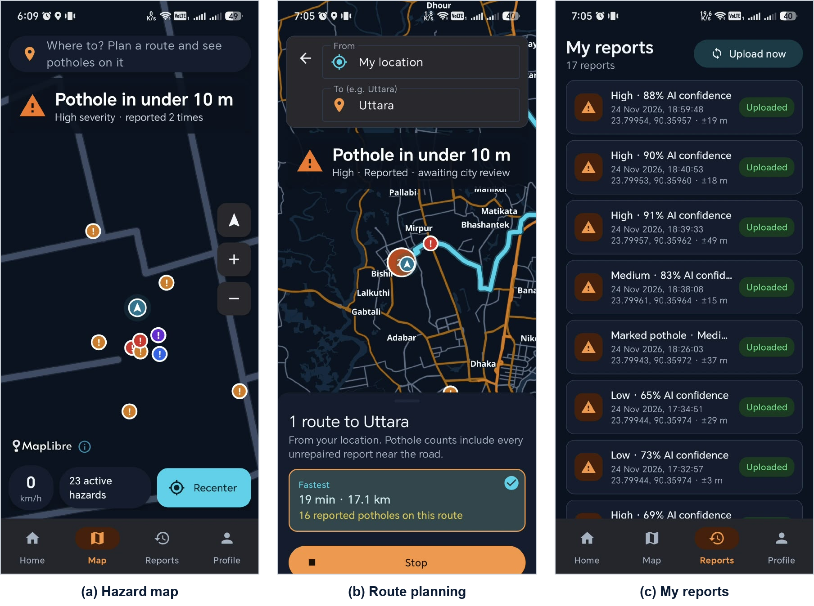
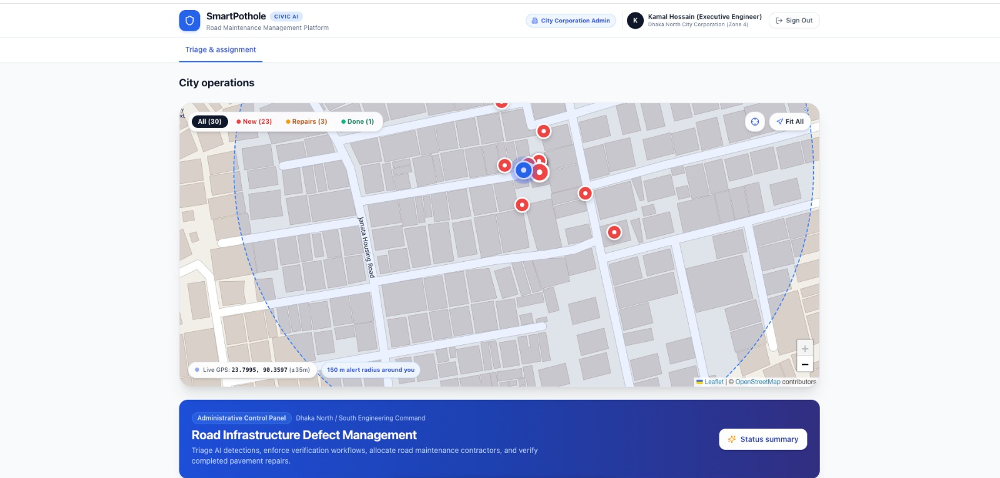
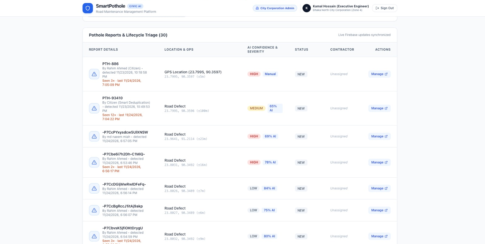
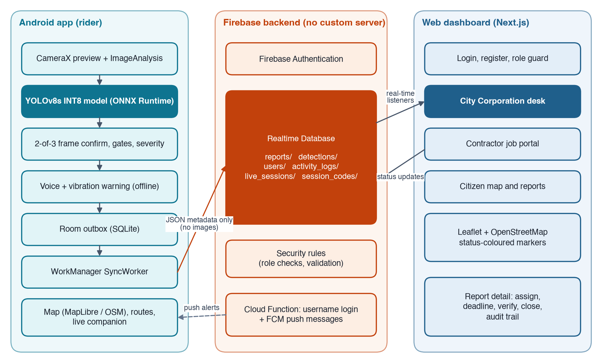

<div align="center">


# SmartPothole AI

### Phones that find potholes on the road, and a city system that gets them fixed.

**On-device YOLOv8 pothole detection (Android) + role-based repair management (Web) + Firebase**

[](https://youtu.be/4Cp7OcaJe8g?si=2Ogdcp3R_DOtYyAc)
[](https://shorturl.at/Ok9CS)
[](https://cryptro.web.app)
[](https://drive.google.com/file/d/1gwy5tVSgR5i_M8F14SBjZcohCMulNZJ7/view?usp=drive_link)

[](https://nextjs.org/)
[](https://developer.android.com/)
[-orange)](https://github.com/ultralytics/ultralytics)
[](https://firebase.google.com/)

</div>

## ▶ Demo video

<a href="https://youtu.be/4Cp7OcaJe8g?si=2Ogdcp3R_DOtYyAc"></a>

Click the image to watch on YouTube. A longer full-project walkthrough is on [Google Drive](https://drive.google.com/file/d/1gwy5tVSgR5i_M8F14SBjZcohCMulNZJ7/view?usp=drive_link).

## 🔗 Try it

| What | Link |
|---|---|
| 📱 **Android app (APK)** and live dashboard | **https://shorturl.at/Ok9CS** |
| 🌐 Web dashboard (Firebase Hosting) | https://cryptro.web.app |
| 🎬 Demo video (YouTube) | https://youtu.be/4Cp7OcaJe8g |
| 🎞️ Full project overview (Google Drive) | [Open video](https://drive.google.com/file/d/1gwy5tVSgR5i_M8F14SBjZcohCMulNZJ7/view?usp=drive_link) |
| 💻 Source code | https://github.com/kazinayeem/smart-road-ai |

**How to use it:** install the APK on an Android phone (allow "install from unknown sources"), register as a rider,
mount the phone facing the road and tap **Start detection**. Potholes are detected on the phone, you get a voice and
vibration warning, and the report appears on the web dashboard, where the City Corporation verifies it, assigns a
contractor and closes it after the repair.

## 📸 Screenshots

| Android: home, live detection, split mode |
|---|
|  |

| Android: hazard map, route planning, my reports |
|---|
|  |

| Web: City Corporation map | Web: report triage |
|---|---|
|  |  |

## 🧭 How it works



1. **Detect:** YOLOv8s (INT8, 10.96 MB) runs on the phone through ONNX Runtime on live CameraX frames.
2. **Confirm:** a pothole must appear in 2 of 3 frames above 0.55 confidence, with a fresh GPS fix.
3. **Warn:** the driver hears "Pothole detected ahead" and feels a vibration, even offline.
4. **Sync:** the report is saved locally first and uploaded when there is signal; repeated sightings merge into one record.
5. **Repair:** the City Corporation verifies and assigns, the contractor repairs, and only the city can close it.

No camera image or video ever leaves the phone. Only position, confidence and time are sent.

## 📚 Project documents (SE 331)

Each document is available as Word and PDF in [`documentation/submission/`](documentation/submission/).

| Document | PDF |
|---|---|
| SRS (lab report) with code of the main features | [01_SRS_Lab_Report.pdf](documentation/submission/01_SRS_Lab_Report.pdf) |
| Project proposal | [02_Project_Proposal.pdf](documentation/submission/02_Project_Proposal.pdf) |
| Code documentation | [03_Code_Documentation.pdf](documentation/submission/03_Code_Documentation.pdf) |
| Diagrams and workflows | [04_Diagrams_and_Workflows.pdf](documentation/submission/04_Diagrams_and_Workflows.pdf) |
| Group discussion | [05_Group_Discussion.pdf](documentation/submission/05_Group_Discussion.pdf) |
| Presentation slides | [06_Presentation_Slides.pdf](documentation/submission/06_Presentation_Slides.pdf) · [PPTX](documentation/submission/06_Presentation_Slides.pptx) |

## 👤 Team

| Name | ID | Role |
|---|---|---|
| **Mohammad Ali Nayeem** | 232-35-022 | Team Lead. Built everything: AI/ML, Android app, web frontend, Firebase backend, testing, deployment, documents |
| Mubashir Alam | 232-35-682 | Group member (attended the group discussion) |
| Nayem Miah | 232-35-628 | Group member (attended the group discussion) |

Daffodil International University · Department of Software Engineering · SE 331 Software Engineering Design
Capstone Project · Section 42_H1 · Submitted to **Dipta Dipayan Kar**

> Built by **Mohammad Ali Nayeem**.

## Technical overview

An end-to-end civic road maintenance system featuring **real-time on-device YOLOv8 AI inference on Android (CameraX)**, **zero camera frame / video uploads (metadata-only telemetry transmission)**, **strict role-gated authentication**, and a **multi-role municipal management web portal** for City Corporations, Contractors, and Citizens. See AUDIT_REPORT.md for what is tested and what is still missing.

---

## 🚀 Key Highlights & Architectural Features

### 1. Strict Authentication & Role Isolation (No Guest Access)
- **Zero Public Data Leakage**: Unauthenticated visitors are restricted strictly to the **Login / Register** portal. No municipal queues, GIS maps, or contractor listings are accessible without authentication.
- **Three Distinct Roles**:
  - `CITY_CORPORATION`: Municipal Executive Engineer dashboard with triage queue, contractor assignment, SLA management, and final verification & closure authorization.
  - `CONTRACTOR`: Dedicated portal for assigned repair jobs, status updates (`IN_PROGRESS`, `REPAIR_SUBMITTED`), and repair notes. **Contractors cannot self-resolve tickets.**
  - `CITIZEN`: Real-time interactive Leaflet GIS map with color-coded severity markers, 1-tap on-device GPS mark submission, and personal submission tracking.
- **Server-enforced security**: roles live in `users/{uid}/role` and are enforced by `firebase/database.rules.json` (tested). Self-registration always creates `CITIZEN`; only a city admin can change roles.

### 2. Live On-Device Android AI Detection (CameraX + ONNX Mobile)
- **Real-Time Continuous Analysis**: CameraX `ImageAnalysis` analyzer feeds frames directly to the quantized YOLOv8 INT8 model (`10.96 MB`) on a dedicated background executor without blocking the preview stream.
- **Zero Image or Video Upload**: Road camera frames and video streams remain **100% on-device**. The mobile client transmits **strictly structured detection metadata**, eliminating bandwidth bottlenecks, battery drain, and storage costs:
  ```json
  {
    "reportId": "PTH-001",
    "reporterId": "USER_ID",
    "detectionClass": "pothole",
    "confidence": 0.94,
    "latitude": 23.8103,
    "longitude": 90.4125,
    "gpsAccuracy": 8.5,
    "timestamp": 1732365000000,
    "source": "LIVE_CAMERA",
    "status": "NEW"
  }
  ```
- **HUD Telemetry**: Live camera overlay displays FPS, inference latency (ms), detection status, confidence %, and detection counter.
- **Duplicate Protection**:
  - 3.5s detection cooldown
  - $\ge 0.55$ confidence threshold
  - 20-meter spatial proximity clustering
  - Auto vs. Manual submission modes

### 3. Offline-First Resilience
- Detections captured without network connectivity are buffered locally in Android SQLite Room DB (`AppDatabase`).
- Android Jetpack `WorkManager` (`SyncWorker`) synchronizes pending records to Firebase Realtime Database upon network reconnection.

### 4. Live Companion Mode (Shared Multi-User Detection)
- **Collaborative Road Hazard Surveillance**: Allows two or more authenticated users to participate in the same live scanning session.
  - **Scanner Mode (User A)**: Mounts device on vehicle dashboard. Executes on-device YOLOv8 edge AI, broadcasting moving GPS breadcrumbs and pothole detections to Firebase Realtime Database. Displays active companion count badge.
  - **Companion Mode (User B)**: Monitors scanning session in real time. Adaptive multi-panel UI displays the scanner's live moving position, breadcrumbs, defect pins on OpenStreetMap, and a live detection stream.
  - **Real-Time Push & In-App Alerts**: Instant notification when a new defect is detected, scanner relocates to a new area (>600m), scanner loses GPS lock (>15s), goes offline (>30s), or session ends.
  - **Strict Zero-Stream Privacy**: No live camera video streaming, no frames or images uploaded. Strictly structured telemetry metadata.

### 5. Instant Local Warnings & Hands-Free Safety (100% Offline)
- **Immediate Detection Warning**: Triggers locally on the scanning device without waiting for Firebase synchronization.
- **Hands-Free Driver Safety**: Offline Android `TextToSpeech` voice prompt ("Warning: Pothole detected ahead") and double-buzz haptic vibration alerts the driver without requiring screen interaction.
- **On-Screen High-Visibility Warning Banner**: Top animated alert banner displays defect confidence and hazard severity.
- **Direction & Heading Awareness**: Distinguishes potholes ahead in the vehicle's path of travel ($\le 65^\circ$ heading delta) from those already passed ($> 70^\circ$).

### 6. Smart Duplicate Detection & Data Separation
- **Separated Schemas**: `potholes/` (physical defects) and `detections/` (individual inspection passes).
- **Spatial Clustering**: Detections within a 20-meter matching window update the existing physical pothole (`totalDetections += 1`), while preserving an immutable record in `detections/`.
- **Atomic Operations**: Firebase transactions ensure concurrency safety when multiple vehicles pass the same pothole simultaneously.

### 7. Mandatory Free & Open Source Mapping (OpenStreetMap)
- **Zero Google Maps Billing / API Keys**:
  - **Android**: `osmdroid` with standard OpenStreetMap tiles (`MAPNIK`), visible OSM attribution watermark, and interactive **Safe Area / Monitoring Horizon Circle** (120m radius).
  - **Web Dashboard**: Leaflet + OpenStreetMap tiles with visible attribution `© OpenStreetMap contributors`, marker clustering, status filters, and 150m Safe Area circle.
  - **Consistent Status Colors**: RED = NEW, ORANGE = UNDER_REVIEW, BLUE = ASSIGNED, YELLOW = IN_PROGRESS, GREEN = RESOLVED, GRAY = REJECTED.

### 8. 9-Stage Municipal Lifecycle & Governance
Tickets transition systematically through:
`NEW` ➔ `UNDER_REVIEW` ➔ `VERIFIED` ➔ `ASSIGNED` ➔ `ACCEPTED` ➔ `IN_PROGRESS` ➔ `REPAIR_SUBMITTED` ➔ `CITY_VERIFICATION` ➔ `RESOLVED`.
- Only `CITY_CORPORATION` can authorize final ticket resolution and closure.

---

## 🔑 Demo Accounts (development only)

Defined in `scripts/demo_accounts.json` and created with the Admin SDK (never through client code):

```bash
cd scripts && npm install
npm run seed:emulator                                   # local emulators
GOOGLE_APPLICATION_CREDENTIALS=key.json npm run seed:prod   # a real project (service account)
```

| Role | Username | Email | Where it can sign in |
|---|---|---|---|
| City Corporation (admin) | `city_admin` | `city@pothole.org` | Web |
| Contractor | `contractor_apex` | `contractor@pothole.org` | Web |
| Citizen / rider | `citizen_rahim` | `citizen@pothole.org` | Web + Android |
| Citizen / rider 2 | `citizen_karim` | `citizen2@pothole.org` | Web + Android |

Passwords are in `demo_accounts.json` (override with `DEMO_<KEY>_PASSWORD`). One-tap demo login
appears on the web only with `NEXT_PUBLIC_ENABLE_DEMO_LOGIN=1`, and on Android only in **debug**
builds (riders only — the Android app is for riders; admins and contractors use the web).

---

## 🛠️ Quick Start

### Security rules (deploy these first)
```bash
cd firebase/tests && npm install && npm test     # 17 rule tests on the local emulator
cd .. && firebase deploy --only database          # requires `firebase login`
firebase deploy --only functions                  # username login; requires the Blaze plan
```

### Web dashboard
```bash
cd web-dashboard
npm install --legacy-peer-deps
npm run build && npm start                        # http://localhost:3300
```
Routes: `/`, `/login`, `/register`, `/citizen`, `/citizen/driver` (simulation only), `/city`, `/contractor`.

### Android app (riders)
```bash
cd android-app
./gradlew assembleDebug testDebugUnitTest
```

See **AUDIT_REPORT.md** for what was fixed, what is tested, and what is still missing.

---

## 📂 Project Structure

```
├── ai-model/
│   ├── exported/           # ONNX exported model (42.67 MB)
│   ├── optimized/          # INT8 quantized ONNX model (10.96 MB)
│   └── scripts/            # Quantization, export & verification tests
├── android-app/            # Native Kotlin Android App (CameraX, ONNX Runtime Mobile, Room)
│   └── app/src/main/
│       ├── assets/         # pothole_yolov8s.onnx asset
│       └── java/org/smartpothole/app/
│           ├── camera/     # CameraActivity & live CameraX analyzer
│           ├── data/       # Room entity, DAO & AppDatabase
│           ├── sync/       # WorkManager SyncWorker
│           └── ui/         # MainActivity & MapActivity
├── web-dashboard/          # Next.js 14 Web Management Dashboard
│   ├── app/                # App router (role-gated page & auth)
│   ├── components/         # AuthScreen, CityCorpDashboard, ContractorView, CitizenView
│   └── lib/                # Firebase Auth & Realtime Database bindings
├── scripts/
│   └── seed_demo_accounts.js # Secure development seed script
└── documentation/          # Architecture, Setup & Database schema specs
```
